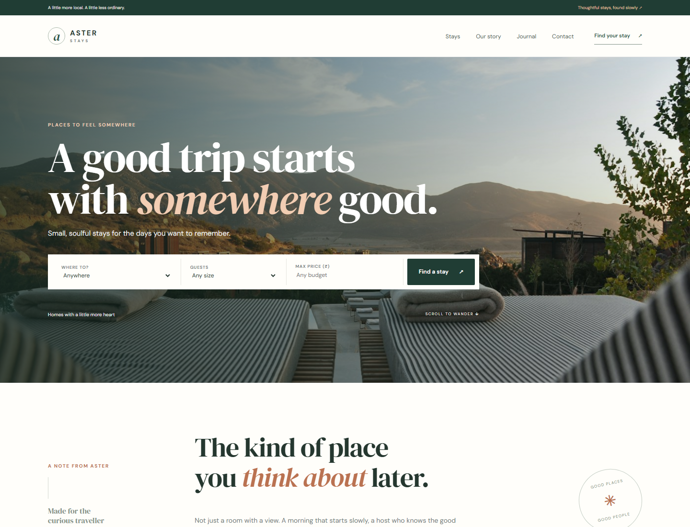

# Aster Stays

Aster Stays is a WordPress showcase project for discovering boutique stays across India. It pairs a custom responsive theme with a small companion plugin for stay content and enquiry workflows.



## Highlights

- Responsive homepage, stay directory, single-stay pages, About, Journal and Contact pages.
- Custom `stay` post type with structured stay details and destination-based browsing.
- Search and filters for destination, guest capacity and budget.
- Stay cards, amenity details, host information and enquiry/booking interface.
- Accessible navigation, semantic templates, responsive layouts and reduced-motion support.
- WooCommerce theme support for store pages when WooCommerce is installed and configured.

## Built with

- WordPress and PHP templates
- Custom Aster Stays theme: HTML, CSS and vanilla JavaScript
- Companion `aster-stays` plugin for the stay post type, admin fields, demo content, shortcodes and booking/enquiry handling
- Optional WooCommerce integration

This repository uses a custom-coded WordPress theme and plugin. Elementor Pro and Crocoblock are not bundled with this project.

## Project structure

```text
wp-content/
├── plugins/
│   └── aster-stays/       # Stay content, metadata and enquiry functionality
└── themes/
    └── asterstays/        # Front-end templates, styles, scripts and images
docs/
└── screenshots/
    └── home.png           # Homepage preview
```

## Run locally with XAMPP

1. Start Apache and MySQL from the XAMPP Control Panel.
2. Put the WordPress project in your web root (for example, `C:\xampp\htdocs\aster-stays`).
3. Create a MySQL database in phpMyAdmin and configure WordPress with your local database settings.
4. Open `http://localhost/aster-stays/` and complete the WordPress setup if prompted.
5. In **Appearance → Themes**, activate **Aster Stays**. In **Plugins**, activate **Aster Stays**; install and activate WooCommerce only if you want its shop features.
6. Visit **Settings → Permalinks** and click **Save Changes** once so the stay archive routes are refreshed.

> The WordPress database is not included in this repository. A fresh local install may need demo content created from the plugin's admin screen. Use your own local database credentials; do not publish them.

## Main routes

- `/` — homepage
- `/stays/` — stay directory
- `/stay/{stay-name}/` — individual stay details
- `/about/`, `/journal/`, `/contact/` — editorial and contact pages

## Notes

- Booking and payment behaviour depends on the plugins and payment gateways configured in the local WordPress installation. Do not treat a demo/local setup as a live booking service.
- Update WordPress, themes and plugins before deployment, use HTTPS, and configure backups and spam protection for a public site.

## License

See [LICENSE](LICENSE) for the repository license.
